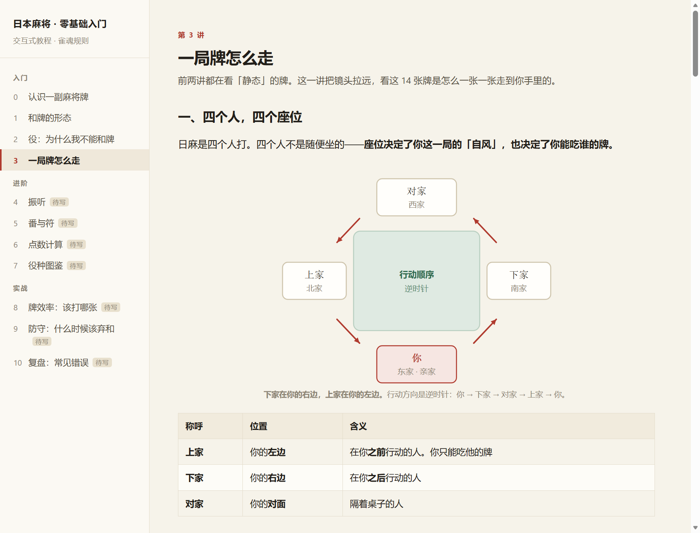
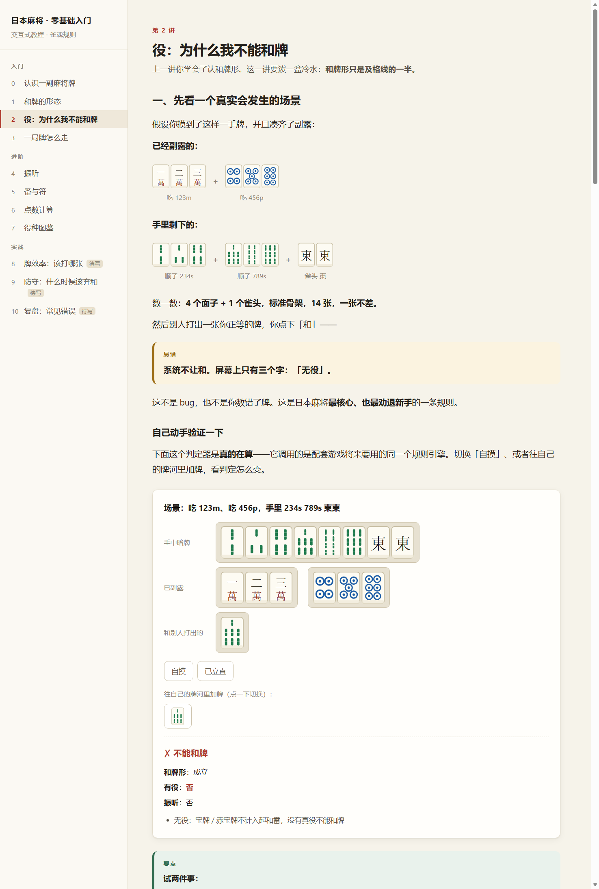

# 日本麻将 · 从零开始

> `riichi-dojo` —— 立直道场。一个把「完全不会打麻将」教到「能自己打完一局」的地方。

以**雀魂四人麻将段位场**为基准规则的日麻项目 —— 从零基础教学，一直做到能打。

**单文件交付，双击即开。** 不需要安装、不需要构建、不需要联网。
样式、脚本、牌面图形、音效、背景音乐全部内联在同一个 HTML 里，连一个外部请求都没有。



## 快速开始

| 你想干什么 | 打开 |
|---|---|
| **学打麻将**（不会打就从这里开始） | `play/index.html` —— 打开是关卡列表 |
| **直接开打** | 同上，基础篇走完就能自由对局；也可以直接进「自由对局」 |
| **通读教程** | `tutorial/index.html` —— 11 讲全文，适合打印或连着看 |
| **查规则** | `docs/rules.md` —— 约 1700 行，含完整规则开关表 |
| **查役种** | `docs/yaku.md` |

> **在线玩**：仓库自带 GitHub Pages 工作流（`.github/workflows/pages.yml`）。
> 在 Settings → Pages 把 Source 设为「GitHub Actions」，推送后即可通过
> `https://<用户名>.github.io/<仓库名>/` 直接游玩，无需下载。
> 该工作流未在真实 Actions 环境实跑过，首次推送后请到 Actions 标签页确认。

**基础篇 6 关**：认牌 → 和牌长什么样 → 为什么不让我和牌 → 一局牌怎么走完 →
该打哪张 → **思路**。走完之后你会拿到一张每巡都能用的检查表，对局里随时能翻。

## 你会看到什么

| | |
|---|---|
|  |  |
| 关卡：先动手，再讲原理 | 引擎驱动的交互判定器 |

---

## 目录

| 路径 | 说明 |
|---|---|
| `play/index.html` | **单文件游戏**。打开是关卡列表（教学），走完基础篇即可自由对局 |
| `play/src/levels/` | 关卡表与关卡界面 |
| `play/src/tasks.js` | 关卡里的动手任务（引擎判对错） |
| `play/src/progress.js` | 关卡进度（localStorage） |
| `play/src/lesson-theme.css` | **自动生成**，见 `tools/make-lesson-theme.mjs` |
| `tutorial/index.html` | **独立的教程阅读版**（11 讲全文，供通读或打印；游戏里已内置） |
| `engine/` | 牌理引擎（纯逻辑，无 DOM 依赖） |
| `game/` | 对局状态机（配牌 / 摸打 / 鸣牌 / 立直 / 和了 / 流局 / 结算） |
| `play/src/` | 对局界面（牌桌渲染 + 适配层 + AI） |
| `ui/tiles.js` | 牌面渲染，关卡、教程、对局三处共用 |
| `docs/rules.md` | **规则规格**（约 1700 行）。14 章 + 3 附录，含 §14 完整**规则开关表** |
| `docs/yaku.md` | **役种全表**。番数、门清 / 副露条件、复合与互斥规则 |
| `tests/` | 全部测试（15 个文件、211 个用例） |
| `research/rules-variants.md` | **三套规则差异对照**（雀魂 / 天凤 / 竞技），我整理的 |
| `research/yaku-fu-score.md` | **役种与符数速查**，我整理的 |
| `shots/` | 界面截图（README 与文档用） |
| `tools/` | 构建脚本、课文样式作用域化、反向验证工具 |

> `research/raw/` 与 `research/src/` 是开发期抓取的**第三方页面副本**，
> 不进版本库（见 `.gitignore`）。规则事实已提炼进 `docs/`，
> 出处与抓取脚本保留在 `research/` 便于复核。

---

## 关卡（新手教程）

没打过麻将的人从这里开始。**基础篇 6 关**走完，就能自己打完一局，
并且知道每一巡该想什么。

### 两篇

| 篇 | 关数 | 内容 |
|---|---|---|
| **基础篇**（必做） | 6 | 认牌 → 和牌形 → 役 → 一局流程 → 该打哪张 → **思路** |
| **进阶篇**（选做） | 6 | 振听 / 番符 / 点数 / 防守 / 役种图鉴 / 复盘 |

### 每一关的固定结构

**基础篇**（先动手，再给原理）：

```
① 动手做    先做，先撞墙（任务由引擎判对错）
② 讲解      做完再看原理（默认折叠，任务完成后自动展开）
③ 再练一次  换一批题，把看懂的东西用一遍
```

**进阶篇**（先看速查表，再自测）：

```
① 讲解      速查表，默认展开
② 自测      一道题验一下
③ 再练一次
```

两篇顺序不同是有原因的。进阶篇那些概念（振听、番符）没先看过根本答不出来，
硬按「先动手」排会变成猜谜。

### 「先动手」有一个前提，我一开始没守住

**先动手只在「玩家手里有足够的材料去推理」时成立。**

第 2 关原本只写「先只看形状：4 个面子 + 1 个雀头就算」，然后直接让一个从没打过
麻将的人判断牌型——他不知道「面子」是什么。**那不是先动手撞墙，是先动手猜谜。**
被读者骂了一次才改。

现在第 2 关的顺序是：**术语表（面子 / 雀头 / 顺子 / 刻子）→ 一个拆开的完整范例 →
才让他动手**。第 1 关同理，动手前先给牌面图例。

判断标准很简单：**一个从没接触过的人看完这一屏，如果仍然只能靠猜，就是该讲的没讲。**

这条现在由测试强制（见「正确性保障」第 6 条）。

### 通关由引擎判定，不是写死的答案

- 「这手牌能和吗」直接调 `canRonReasons`，答错时把**为什么不能和**一并说出来
- 「该打哪张」由 `discardUkeire` 现算向听数与进张数，和最优解对比
- 「打一局」只要打完一局就算过，不看输赢

### 思路卡 —— 基础篇的最终产物

第 6 关把一张检查表交到玩家手里，之后**对局中右上角随时能翻**。
学的时候看的和打的时候查的是同一份 HTML，不可能漂移成两套说法。

> **每一巡问三个问题**：我离和牌多远？我在做什么役？有人立直吗？
>
> **三个动作前各查一句**：
> 打牌前看听牌 · 吃碰前看剩什么役 · 和牌前说得出役名。

进度存在 `localStorage`，刷新不丢。读写都包了 try——隐私模式下存储会直接抛
异常，不该因此让整个游戏打不开。

---

## 自由对局

关卡列表里点「开始对局」就是完整的四人半庄：你坐东家，另外三家由 AI 操作。

- **规则**：雀魂四人段位场（`SAKURA_4P`），与 `docs/rules.md` 完全一致
- **操作**：点自己的牌打出；有吃碰杠和的机会时，动作按钮出现在手牌下方
- **可复现**：开局可选固定随机种子，同一 seed 的对局逐事件完全一致
- **思路卡**：右上角随时翻

### AI 分级

全部是确定性算法，没有机器学习。牌效率 AI 的完整决策依据就是引擎的
**向听数 + 进张数**——第 5 关的「该打哪张」训练器已经用它选出了最优解。

| 等级 | 策略 |
|---|---|
| Lv1 | 随机打牌（陪练认牌用，会无役、会振听） |
| Lv2 | 牌效率：向听最小 + 进张最多 |
| Lv3 | 牌效率 + 防守：自己两向听以上时改打现物 |

想换成 Mortal 那类模型，只需要替换 `play/src/ai.js` 里的 `chooseDiscard`。

### 两条必须守住的设计约束

**① AI 只在「合法动作集合」里挑，绝不自己造动作。**
一开始没守住：AI 先算出最优打牌再直接用，但立直之后只能摸切，于是生成了
非法打牌，接上真实状态机时立刻炸。现在 `chooseDiscard(state, seat, legal)`
会把候选池按合法集合过滤。

**② 「现在该做什么」只能问合法动作集合，不能看 phase。**
同一个错误我在渲染层和循环层各犯了一次：状态机摸完牌后仍然报 `phase === 'draw'`，
而此刻打牌早已合法。渲染层的表现是「14 张牌全是灰的点不动」，循环层的表现更严重——
每次回调什么都不做又排下一次计时器，**界面原地空转**。测试跑一轮要 90 秒
（其实在空转）就是它的症状；修完降到 4.5 秒。

---

## 引擎

纯 ES module JavaScript，无外部依赖。牌的表示全项目统一：

```
0–8   一萬～九萬 (m)
9–17  一筒～九筒 (p)
18–26 一索～九索 (s)
27–33 東 南 西 北 白 發 中 (z)
34/35/36 = 赤 5m/5p/5s（输入别名，入口归一到 4/13/22）
```

手牌是**长度 34 的计数数组，且只含暗牌部分**；副露单独用 `melds` 数组传入。
注意：状态机里的 `hand` 是「当前实际持有」，摸牌后即为 14 张。

| 模块 | 内容 |
|---|---|
| `tiles.js` | 牌表示、花色 / 幺九 / 字牌判定、`parseHand`、宝牌指示牌 |
| `agari.js` | 和牌分解（返回**全部**拆解方案，供高点法与一杯口 / 二杯口判定使用）、七对子、国士无双 |
| `shanten.js` | 向听数。**递归与 DP 两套独立实现**，交叉对照 |
| `waits.js` | 听牌、进张、`discardUkeire`（打牌分析） |
| `yaku.js` | 役种判定（`YAKU_DEFS` 为役种唯一事实来源）、高点法 |
| `fu.js` | 符数计算，返回**逐项明细**（教学要用） |
| `score.js` | 点数计算、满贯界限、本场与立直棒 |
| `furiten.js` | 三种振听 + `canRonReasons`（带原因的荣和诊断） |
| `rules.js` | 规则开关与预设（`SAKURA_4P` / `TENHOU_4P`） |

### 构建

```bash
npm run build              # 两个产物一起构建
npm run build:game         # → play/index.html
npm run build:tutorial     # → tutorial/index.html
npm run theme              # 改了教程样式后必跑（见下）
```

构建脚本会校验导入名是否存在、拼接结果能否通过语法检查，失败时把产物落盘便于排查。

**为什么改了教程样式要单独跑 `npm run theme`**：关卡页里复用的课文样式，
是脚本从 `tutorial/src/style.css` **自动作用域化**到 `.lesson-body` 生成的
（否则教程的浅色主题会和游戏的深色主题互相覆盖）。手抄一份迟早漂移，所以是生成的。

### 跑测试

```bash
npm install        # 只需一次，装 jsdom
npm test           # 标准做法：node --test tests/
```

**如果你的环境禁止 Node 以管道方式 spawn 子进程**（比如某些沙箱或 CI 限制），
`node --test` 会因为拿不到子进程输出而失败。换成逐个文件执行：

```bash
npm run test:files
```

两者跑的是同一批用例。当前共 **15 个测试文件、211 个用例**。

### 反向验证（可选但强烈建议）

改完校验代码后，往源码里注入一个**已知的 bug**，确认测试真的会报警：

```bash
npm run inject                    # 列出所有可注入项
node tools/inject-bug.mjs loud    # 注入：把打牌声放大到会削波
node tests/audio-ui.test.mjs      # 应当失败
node tools/inject-bug.mjs --restore
```

**为什么需要这个**：写完校验最容易犯的错是「以为测过了」。这个项目在这件事上
栽过两次 —— 其中一次补丁因为 shell 转义失败**根本没生效**，两次跑都是绿的，
看起来像验证过了，其实什么都没验证。所以脚本会确认替换真的发生、
注入后文件仍是合法 JS，需要重建产物的注入项还会自动重建。

---

## 声音

全部是**实时合成**的，没有一个音频文件。原因很直接：单文件交付不能带外部资源，
而 1 秒 44.1kHz 单声道就 ≈ 88KB，base64 后 ≈ 117KB —— 几个音效就 500KB+。
合成的话体积是零，还能每次微调，听不腻。

代码在 `ui/audio.js`，用 Web Audio 的噪声 + 滤波 + 包络现场搭出音色。

| 音效 | 用在哪 |
|---|---|
| `discard` / `draw` | 牌落桌、摸牌 —— 整个游戏里最重要的两个音 |
| `meld` / `kan` | 吃碰、杠（逐张加重，听得出轻重） |
| `riichi` / `dora` | 立直、翻宝牌 |
| `win` / `drawEnd` | 和牌、流局 |
| `click` / `yourTurn` | 按钮、轮到你 |
| `correct` / `wrong` / `levelUp` | 练习判定、通关 |

### 背景音乐

**Erik Satie《Gymnopédie No. 1》（1888）**，公有领域。

音符与和声取自 [Mutopia Project 的 LilyPond 谱源](https://www.mutopiaproject.org/ftp/SatieE/gymnopedie_1/gymnopedie_1.ly)
（`license = "Public Domain"`）—— **不是凭记忆默写的**。凭记忆写古典旋律，很容易
写出「像萨蒂但不对」的东西，那和之前那道副露题是同一种错误：把不是 X 的东西标成 X。

音区选择与配器是改编决定：8-bit 编制只有三个声道，不可能照搬钢琴谱。

**为什么选这首**：它标着「Lent et douloureux」（缓慢而痛苦），3/4 拍，刻意不抢注意力。
麻将一局可能打十分钟，而玩家在思考——音乐必须比音效更轻。

乐谱写成数据（音符 + 时值），几百字节存下一整首循环，**体积零增长**。播放走一个
前瞻式音序器（提前 1.2 秒排程，不用 `setTimeout` 卡点——那样的抖动在音乐里非常明显）。

音色是 NES 那套：**脉冲波按占空比展开傅里叶级数**（12.5% / 25% / 50% 的音色差别很大）、
三角波做低音、噪声备用。和音效**分开开关**：音乐是氛围，音效是信息，
想关掉一个不该被迫连另一个也关掉。默认音量 0.16，只有音效（0.32）的一半。

### 听感的三条原则（比「加音效」本身更重要）

1. **默认音量要小。** 默认 100% 是听觉灾难。这里默认 0.32，右下角随时可关。
2. **每次不能完全一样。** 同一个打牌声重复上百次会让人立刻关掉声音 ——
   每次给音高 ±5%、音量 ±8%、时长 ±10% 的随机偏移，大脑就认它是自然的。
3. **留白。** 和牌那一刻先静 130ms 再给音效，直接糊上去会显得廉价。

另外两条工程约束：浏览器不允许自动播放，所以 AudioContext 等第一次
`pointerdown` 才创建；重要声音（和牌、立直、判定）**不受限流影响** ——
限流是给每巡都响的打牌声准备的，把和牌声吞掉比多响一声糟糕得多。

### 视觉质感

风格没变（深绿呢面 + 金线 + 浅色手册页），只补了四处：

- **牌的立体感**：牌面分三层 —— 正面、下缘一圈更暗的「厚度」、上缘内侧一道
  1px 高光。高光很淡，小尺寸下糊不了，但少了它牌就是一张贴纸。
- **桌面材质**：一层 `feTurbulence` 生成的噪点，不透明度压到 0.028。
  看得出来有质感，但永远注意不到它。
- **牌河在桌子中间**：四家各占一条边围成一圈，中间是场次信息 —— 这是麻将的
  物理事实（打出的牌落在桌子中央）。早先把牌河塞进各家的座位面板里，190px 宽的
  栏里挤 6 列，既看不出是谁打的，也数不清张数。窄屏放不下四条边时退化成 2×2，
  四家仍然都在，只是不再按方位排。
- **动效**：打出的牌落桌、摸进的牌滑入、结算浮层上浮。全部 200ms 上下，
  只做位移和淡入 —— 麻将本来就快，动画一长就变成等待。

两个必须处理的细节：

- **动画不能无脑挂。** 牌桌是每次事件都整块重建 `innerHTML` 的，动画类若无脑
  挂上，牌河最后一张会每帧重新「啪」一次，看着像抽搐。`table.js` 里记了上一帧的
  状态签名，只有内容真变了才播。
- **`prefers-reduced-motion` 必须尊重。** 开这个开关的人往往有前庭功能方面的
  原因，动画不是审美偏好而是生理不适。

---

## 提示（对局里）

右上角「提示」按钮，给玩家一条**带理由**的建议。只按**最常用的和牌方式**推荐：

```
门清做牌 → 听牌 → 立直 → 荣和
```

优先级：能和就和 > 能立直就立直 > 不鸣牌 > 打向听最小、进张最多的那张。

刻意**不做**押引判断、不看点数状况、不读对手 —— 那些是另一个层次的东西，
混进来只会让新手看不懂「为什么推荐这张」。

每条提示都必须同时给出「打什么」和「为什么」，否则玩家只会照抄，
永远学不会自己判断 —— **这个功能的目的是把人教到不需要它**。例如：

> **打 九萬**
> 打掉它之后：一向听，有效进张 24 张。这是唯一的最优解。
> 打掉之后听：二筒、五筒。能和的话，役是：断幺九。

以及新手最容易死的那一处，会直接报警：

> ⚠ 你已经鸣过牌，这样听牌**没有役**：就算别人打出你听的牌，也不能和。

所有数字都由引擎现算（`discardUkeire` / `canRonReasons`），提示和判定器
不可能给出互相矛盾的说法。

### 「理由」是怎么来的（说清楚，免得误解）

**没有语言模型，没有「生成」。** 每一条理由都是：

```
手写的句子模板  +  引擎算出来的数字/真假值  +  几个条件分支
```

| 提示里的部分 | 来源 |
|---|---|
| 「打 九萬」 | `discardUkeire()` 挑出的最优解 |
| 「一向听」 | `shanten()` 返回值查一张写死的表 |
| 「有效进张 24 张」 | 该选项的 `total`，引擎求和 |
| 「这是唯一的最优解」 | 数同分候选：1 个说这句，多个说另一句 |
| 「打掉之后听：二筒、五筒」 | 枚举「加一张能否和」（`isAgari`） |
| 「能和的话，役是：断幺九」 | `canRonReasons()` 返回的役种列表 |
| 「它和手里其他牌都挨不着，是一张孤张」 | `describeTile()` 的结构判断 |
| **所有句子的措辞** | **手写的** |

好处是每个数字都可追溯、结果确定、模板可测试（生成的散文测不了）。
代价是**模板不知道上下文，会在边界情况说错话**。

### 模板踩过的两个坑（都已修）

**① 误报。** 早先的「没役」警告只看「有没有副露」：

```js
else if (best.shanten <= 2 && meldCount) { warning = '⚠ ...还没看出役在哪...' }
```

结果**碰了白（役牌已经在手、方向清清楚楚）的玩家也会被唠叨**。
数字（向听数）是对的，但由数字推出的那句话是断言的，而断言没覆盖这种情况。
现在加了一层 `settledYaku()` —— 先查手里有没有板上钉钉的役
（役牌 / 断幺九 / 一色系 / 门清），有就不报。

**② 只给数字不给理由。** 「有效进张 24 张」是数字，不是理由；
人教练会说「九萬和手里其他牌都挨不着」。现在由 `describeTile()` 补上这张牌的
结构角色（孤张 / 搭子 / 对子 / 刻子 / 字牌）。

`describeTile` 写出第一版时有个真 bug：邻居判断收的是**点数**，
我却传了**偏移量**，于是查的是「点数 -2、-1」的位置 —— **任何牌都会被判成孤张**。
测试当场抓住（「3p 和 4p 应当算搭子」）。

---

## 正确性保障

规则项目最怕的是「悄悄教错」。目前的防线（**211 个用例，0 失败**）：

1. **引擎测试**：和牌分解、向听数的三重交叉验证（自洽性穷举 + 双算法对照 +
   手工边界）、役种正反例、符数边界、点数表逐格比对。
2. **状态机测试**（74 用例）：200 场自动对局，**每一步**校验不变量——全场
   136 张守恒、每种牌 ≤ 4、四家点数 + 供托 = 100000、岭上 / 开杠 ≤ 4。
3. **界面渲染测试**：对真实 GameState 逐步渲染，断言不泄漏 `undefined` / `NaN`。
   这一层抓到过字段名对不上、手牌重复计入摸牌、结算对象结构假设错误。
4. **端到端 DOM 测试**：jsdom 里真跑构建产物，点按钮走完关卡、打完多局。
   抓到过会让游戏卡死的死循环，以及「完成任务把另一个任务弄没」的重渲染 bug。
5. **教程内容校验**：把每一讲渲染成 HTML，再**从 HTML 里把牌反解回来**，
   检查「标着顺子的三张是不是真的连续」「一手牌里有没有 5 张同一种牌」
   「正文里有没有孤立的花括号」。
6. **关卡内容校验**：关卡里每一手牌都是手挑的，手挑就会挑错。形状题直接问
   引擎「是不是和牌形」、荣和题直接问引擎「能不能荣和」，并核对任务 key 与
   实际渲染出的任务数一致。这一层存在的直接原因，是我在第 2 讲写过一道
   **答案相反**的例题。
7. **课程完整性校验**：追踪 22 个「光看字面猜不出意思」的术语（面子、雀头、役、
   向听数…），强制两条硬规则——基础篇的动手区**不得出现还没讲过的术语**；
   进阶篇自测里用到的术语**必须能在本关速查表里找到**。这一层是被读者骂出来的：
   第 2 关曾直接让人判断「4 个面子 + 1 个雀头」，而他从没见过「面子」这个词。
8. **音效与动效校验**：用假的 AudioContext 把合成过程**录下来**，再验证三件
   真正影响听感的事——叠加峰值不削波也不小到听不见、同一个音每次有随机、
   限流不吞重要声音。声音没法在测试里听，但合成了什么是可以量的。
   这套检查当场抓出两处：点击声过完主音量只剩 0.019（≈ −34 dBFS，笔记本上约等于没有），
   以及连播打牌声之后的和牌声会被限流吞掉。
9. **提示校验**：提示给新手的建议**必须真的在合法动作集合里**（绝不自己造动作，
   这条 AI 上栽过一次），并且要跟引擎现算的最优解逐手对上；
   再在真实牌局里跑 5 个种子、逐手校验人类每次决策。
   另外专门钉住「鸣过牌又没役」这个新手最常见的死法 —— 必须报红色警告，
   不允许静悄悄地推荐一张牌。
10. **反向验证工具**（	ools/inject-bug.mjs）：往源码里注入一个已知的 bug，
    确认对应的测试真的会报警。目前四项：副露图平铺、音效爆音、提示误报、
    牌型角色判断错。这是个**必须有的**工具 —— 「写完校验以为测过了」已经栽过两次，
    其中一次补丁压根没生效，两次跑都是「通过」，看起来像验证过了，其实什么都没验证。
    所以脚本会确认替换真的发生、且注入后文件仍是合法 JS（括号配平），否则直接报错退出。
    **还有一条更隐蔽的**：play-dom.test.mjs 读的是构建产物而不是源码，
    改完源码不重建，测试跑的还是旧代码 —— 注入「成功」了却测不出任何东西。
    所以注入项可以声明 uild，脚本会自动重建（还原时也重建）。
11. **版面校验**：四家牌河必须在桌子中央围成一圈（座位面板里不许留牌河），
    相对座位也要对（自己=下 · 下家=右 · 对家=上 · 上家=左）。
    「每行 6 张」这类断言直接查样式表 —— jsdom 不做布局，
    只断言渲染出的 DOM 是查不出列数的，那样写等于没测。
12. **退出对局**：必须二次确认；确认后定时器要清干净（断言待触发数量为 0，
    而不是「drain 之后界面还对」—— advance() 开头有 if (!S) return，
    没清的定时器醒来也只是什么都不做，那样断言等于没测）；
    中途退出不能把第 4 关的「打完一局」误判为完成。
13. **背景音乐校验**：乐谱写成数据，所以**可以逐音符验** —— 音名能不能解析、
    3/4 拍的旋律有没有溢出小节、三个声部的音量层次对不对（按**听感响度**比，
    不是比振幅：三角波同振幅听起来比方波轻得多）、音区是否合理、
    以及曲目来源与许可有没有被改动。
14. **点数速查表由公式程序化生成后逐格比对**；**役种表直接从引擎的 `YAKU_DEFS`
   生成**；**课文的浅色主题由脚本从教程样式作用域化生成**。三处都不手抄，
   所以不可能漂移。

每个校验器都做过**反向验证**：故意注入错误，确认它真的会报警。
空测试比没有测试更危险——事故恢复时第一版脚本跑出「全部通过」，
其实是因为文件压根没被修改。

---

## 附录 A：一次源码事故与恢复

**事故**：用 PowerShell 批量改 import 路径时，命令被 shell 解析出错，
把 17 个源码文件里的**每一个 `'` 都替换成了 `.`**（`'./ui-tiles.js'` →
`../ui-tiles.js.`）。替换逐字符、不改长度，所以文件语法全废但位置信息还在。

**第一次恢复失败**：写了个状态机脚本想按上下文把引号还原。规则在 `'../`
这种组合上自相矛盾，而且**不幂等**——我跑了两遍，把中间态又改坏了一层。
教训：修复脚本必须先证明幂等，再允许写盘。

**最终做法**：放弃猜引号，改用**事故前最后一次成功构建的 bundle 反编译**。
bundle 里逐字保存着每个模块的函数体（只剥掉了 import / export 行、统一加了
4 空格缩进），于是可以精确还原：模块体去掉 4 空格、import 绑定从解构行反推、
`export` 前缀按导出表加回声明。

**验证**：重建出的 bundle 与事故前的产物**逐行完全一致**（7574 行，0 处差异）。
这比任何单元测试都强——它证明整个程序与事故前逐字节等价。

### 附录 A.2：编码教训（同样的事发生了两次）

两次事故**根因是同一个**：拿 PowerShell 的文本 cmdlet 去处理 UTF-8 中文文件。

| 事故 | 操作 | 后果 |
|---|---|---|
| 第一次 | `$t.Replace(...)` 批量改 import | 命令里的 `'` 被 shell 吃掉，文件里的 `'` 全变成 `.` |
| 第二次 | `Get-Content -Raw` + `Set-Content` 改一行字 | PS 5.1 按 cp936 读 UTF-8，`Set-Content` 把乱码写回，**249 处中文被毁**，最终只能整篇重写 |

**规则**：改这个仓库里的任何 UTF-8 文本文件，用 `write` / `edit` 工具，
或者用 Node 脚本（`fs.readFileSync(p,'utf8')` + `writeFileSync`）。
**不要**用 `Get-Content` / `Set-Content` / `-replace` 流水线——
Windows PowerShell 5.1 默认按 ANSI(cp936) 解析无 BOM 的 UTF-8。

确需在 PowerShell 里写文件，用 .NET 显式指定编码：

```powershell
$enc = New-Object System.Text.UTF8Encoding($false)
[System.IO.File]::WriteAllText($path, $text, $enc)
```

顺带一提，`-Encoding utf8NoBOM` 是 PowerShell **7** 的参数。这台机器上是 5.1，
传了会直接报参数绑定错误——而且**文件一个字节都不会改**，表现为「测试通过」，
比报错更隐蔽。

---

## 已知的未决项

`docs/rules.md` 附录 C 列了完整清单。主要的两类：

- **雀魂官方规则页取不到**（官网是 JS 单页应用，`wiki.biligame.com` 有反爬）。
  雀魂侧的取值来自萌娘百科条目原文（逐条列出段位场规则）加交叉印证，
  标为 `[二手]`。仍有几项标 `[待核实]`。
- **平台分歧项**已全部做成开关（切上满贯、连风牌雀头符、双倍役满、国士抢暗杠等），
  默认值取雀魂。

状态机侧未实现的：三麻（规则、引擎、状态机都已预留差分，见 `docs/rules.md` §13）、
天凤口径的三家和了流局、末亲和了止め / 聴牌止め、牌谱回放。

---

## 牌面

牌面是**内联 SVG 现画**的，不用图片也不用 Unicode 麻将字符。原因：

1. 单文件交付不能带外部资源
2. Unicode 麻将字符（U+1F000 区）在 Windows 上字体支持参差，会掉成豆腐块
3. 现画才能做「赤牌变红」「无效牌变灰」「高亮」这类教学态

索子改过四版才定稿：圆角药丸 → 纺锤形 → 细长竖条。**矮牌只画一道竹节线**，
因为两道白线会把小尺寸的竹节切成虚线，新手会多数一张。
教学用的牌面，可数比好看重要。

---

## 许可与来源

代码以 **MIT** 许可发布，见 [LICENSE](LICENSE)。

### 背景音乐

**Erik Satie《Gymnopédie No. 1》（1888）**，作品本身已进入公有领域。
乐谱数据取自 [Mutopia Project 的 LilyPond 谱源](https://www.mutopiaproject.org/ftp/SatieE/gymnopedie_1/gymnopedie_1.ly)
（该文件标注 `license = "Public Domain"`）。音区选择与配器为本项目所作改编。

**为什么不直接内嵌音频**：一分钟的循环即使压到 32kbps 单声道也要 240KB，
base64 之后 +320KB —— 单文件体积直接翻倍。而 8-bit 的三个声道
（脉冲波 / 三角波 / 噪声）**可以完全实时合成**，乐谱写成数据只有几百字节。

### 规则来源

规则实现以 `docs/rules.md` 为准。该文档由本项目撰写，其中的规则事实来自
公开发布的规则文本（雀魂 / 天凤 / 日本职业麻将联盟 / 世界麻将规则）。
规则本身是事实与方法，不受著作权保护。

**本项目不分发任何第三方页面的原文副本** —— 开发期抓取的网页存档
（`research/raw/`、`research/src/`）不进版本库，见 `.gitignore`。
保留的是我整理的差异对照、速查表，以及抓取脚本（脚本不含内容），便于复核。

### 牌面

`ui/tiles.js` 中的麻将牌图形为本项目用内联 SVG 绘制。

---

## 发布信息（给维护者）

新建 GitHub 仓库后，**About** 栏填这段（中英双语，两边都搜得到）：

```
日本麻将（立直麻将）从零基础教到能打：规则文档 + 6 关新手关卡 + 可玩四人半庄。
单文件 HTML 双击即开，无需安装、无需构建、无需联网。

Riichi mahjong from absolute zero — rules, interactive lessons, and a playable
game in one self-contained HTML file. No install, no build, works offline.
```

**Topics** 标签（GitHub 站内的发现机制，比仓库名管用）：

```
riichi-mahjong   japanese-mahjong   mahjong   tutorial   chinese
game             html5              web-audio offline    beginner-friendly
single-file      vanilla-js         no-dependencies
```

**仓库名**：`riichi-dojo`（立直道场）。
名字的职责是**被找到**，README 标题的职责是**一眼说清是什么** —— 所以两者故意不同。
中文用户在 GitHub 搜「日麻」，命中靠的是 About 和 README，不是仓库名。


